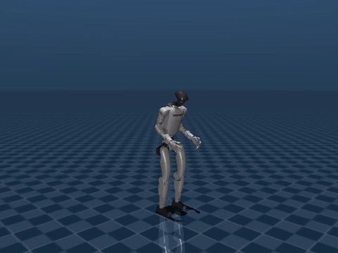
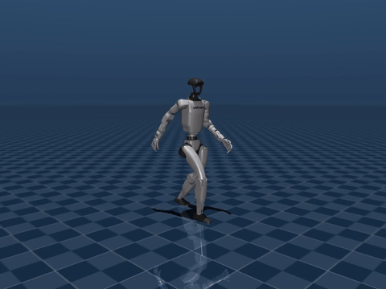

# emotive-gait

Emotion-modulated humanoid gait in MuJoCo. Six continuous emotion intensities (anger, disgust,
fear, happiness, sadness, surprise) are mapped through three affective axes onto the parameters
of a walking gait for the Unitree G1. Every claim the model relies on is either cited to a
source or explicitly flagged as unsourced.

| Sadness = 1.0 | Anger = 1.0 |
| --- | --- |
|  |  |

## Quickstart

```sh
python -m venv .venv
source .venv/bin/activate        # Windows: .venv\Scripts\activate
pip install -e ".[dev]"
python -m mujoco_menagerie prefetch unitree_g1
emotive-gait demo --emotion sadness=0.8     # writes demo.mp4 (needs ffmpeg on PATH)
emotive-gait evidence                       # every claim with its grounding and citation
pytest
```

`demo` also takes `--physics`, `--root {free,z-rail,xz-rail,weld}` (`xz-rail` is experimental,
see Limitations), `--camera {tracking,fixed}` (the video camera follows the pelvis by default),
`--hold-speed`, `--gif` and `--dry-run`; see `emotive-gait demo --help`.

With `--physics` the CLI prints a report after the run: `root`, `fell`, `zmp_outside_frac`,
`zmp_mean_margin_m`, `foot_slip_rms_m_s`, `pelvis_bob_m`, `pelvis_tracking_ptp_m`,
`pelvis_held` and a `played_params:` line listing every parameter the chosen root changed
before playing it. If the parameters are beyond what the robot's legs can reach (the IK
feasibility check), the CLI prints one `warning: parameters exceed the robot's reach` line and
still renders.

## Requirements

Python 3.11 or newer, 3.12 recommended. `mujoco-menagerie` downloads the robot model on first
use and extracts it with `tarfile.extractall(filter=...)` (PEP 706), which needs Python 3.11.4
or newer. If that step fails the loader raises an error naming the prefetch command above and
the sparse-checkout fallback. On Python below 3.11.4 the `prefetch` command itself fails with a
raw `TypeError` traceback (a `mujoco-menagerie` bug); run `emotive-gait demo` instead, which
reports the same failure as an actionable message. MuJoCo 3.17.x (pinned `>=3.17,<3.18`);
`mink` and `qpsolvers[daqp]` are installed with the package.

## Architecture

**`robot/`** maps semantic joint roles (hip pitch, elbow, neck pitch, ...) to actuator names, so
nothing above it hard-codes a model. The G1 has no neck, yet head inclination is the strongest
posture cue in the literature, so the loader injects a pitch neck joint and splits the head's
mass out of the torso.

**`gait/`** defines `GaitParameters`, which are the same quantities the literature reports
(cadence, step length, trunk and neck pitch, arm swing, ...). Joint trajectories are periodic
C2 curves. `footsteps.py` computes foot and pelvis paths as pure functions of the parameters
and the gait phase; `ik.py` solves those foot targets for leg joint angles with `mink` on a
welded-root copy of the robot; the generator combines the IK legs with the spline-driven arms,
trunk and neck into per-role angles over a gait cycle.

**`emotion/`** runs evidence, then axes, then the model. The evidence module records signed
directions (more, same, less) with a citation and a grounding level for each claim. Emotion
intensities become activation, valence and tension, and those shift the parameters. The model
encodes directions, not magnitudes; the gains are tuned, not cited.

**`sim/`** has a kinematic tier that poses the robot with no physics and walks it forward with
exact foot placement (the source of stimuli for video), and a physical tier that steps position
servos open loop with the pelvis on a vertical rail. ZMP and center-of-pressure are measured
for instrumentation and never used for control.

## Limitations

- The kinematic tier walks forward: the stance foot stays put in the world (under 1 mm) and
  the pelvis advances 2 x `step_length` per gait cycle. With today's tuned gains sadness = 1.0
  covers roughly 2 m in 6 s (about 0.33 m/s) and anger = 1.0 about 7 m (about 1.13 m/s); these
  are outputs of the tuning, not acceptance targets.
- The physics tier steps in place on the vertical (Z) rail with position servos, open loop, and
  reports instead of controlling. Its report gives the ZMP margin, foot slip and pelvis
  tracking against the commanded path. For example, the neutral gait for 3 s on the Z rail:
  `zmp_outside_frac` 0.0042, `zmp_mean_margin_m` 0.0379, `foot_slip_rms_m_s` 0.024 / 0.029,
  `pelvis_bob_m` 0.0545 (includes the commanded bounce), `pelvis_tracking_ptp_m` 0.0235
  (uncommanded). A constrained root plays a projection of the parameters (`played_params:`
  lists what changed): the Z rail zeroes `step_length` and `lateral_sway_amp`; the weld also
  zeroes `com_bounce_amp` and fixes `com_height_scale` at 1.0; the free root plays everything
  and falls.
- `--root xz-rail`, a prescribed forward slide, is experimental and falls under stride: the
  neutral gait loses foot contact (first gap at 0.074 s) and falls at about 0.54 s. A servoed
  rail (kp 5000 to 100000, ramped) failed the same way, at 0.52 to 1.12 s. Forward walking is
  therefore a kinematic-tier result; the physics tier is in place. It is kept as a measured
  negative result.
- Open-loop stepping on a free floating base falls within 0.74-2.25 s at every expressive
  amplitude we measured, and there is no balance controller.
- Lateral sway is lost on every rail. Soles are level in stance and may pitch in swing (worst
  about 0.034 rad on neutral); there is no heel-to-toe roll.
- `com_height_scale = 1.0` is a tuned 0.68 m pelvis walking height, below the straight-leg
  0.79 m stand. Higher leaves anger's long steps out of reach and lower runs the ankle into its
  pitch limit. Fear's crouch is faint (`com_height_scale` -0.02, about 1.4 cm) because the
  G1's ankle range binds; deeper crouches fail the feasibility test. That is a robot
  limitation, not an evidence claim.
- Disgust and surprise have no gait kinematics in any source we found. They ship as placements
  on the arousal/valence plane, flagged `UNSOURCED`, and the CLI warns when you use them.
- No recognition rate has been measured: nobody has yet checked that people read these gaits as
  the intended emotions.

## Grounded versus unsourced

| Emotion | Grounding | Primary source |
| --- | --- | --- |
| anger | measured speed, directional posture | Roether et al. 2011 |
| fear | measured speed, directional posture | Roether et al. 2011 |
| happiness | measured speed, directional posture | Roether et al. 2011 |
| sadness | measured speed, directional posture | Roether et al. 2011 |
| disgust | unsourced | none |
| surprise | unsourced | none |

Other cited sources include Montepare 1987, Michalak 2009, Gross 2012, Barliya 2013,
Halovic and Kroos 2018, and Randhavane 2019. `emotive-gait evidence` prints the full table.

## Related work

- **EMoG** ([arXiv 2609.14432](https://arxiv.org/abs/2609.14432)): emotion-modulated gait
  generation from a continuous style code through an MLP and an RL tracking policy, trained on
  a proprietary performer dataset. Which robot it used is unverified.
- **PAMoR** ([arXiv 2608.28213](https://arxiv.org/pdf/2608.28213)): parameterized affective
  motion generation in real time; the closest in approach.
- **EmoPose** ([arXiv 2609.23414](https://arxiv.org/pdf/2609.23414)): emotion-aware gesture,
  not gait.
- **Walk Like This**: stylized locomotion via example-driven diffusion.

This project differs in being analytic, interpretable, cited and open, where EMoG is learned
from a proprietary dataset. That is a difference, not an advantage.

## License

MIT. The Unitree G1 model is BSD-3-Clause, from MuJoCo Menagerie.
